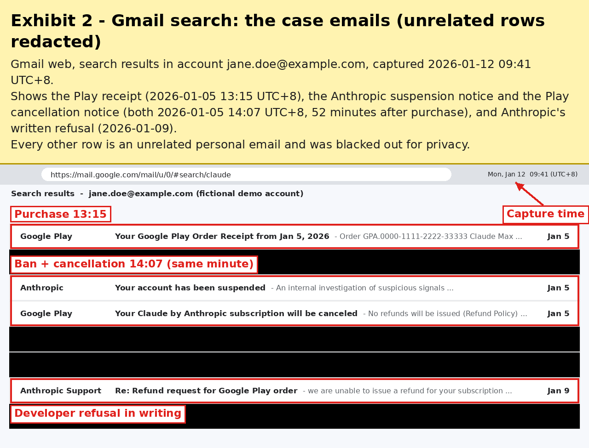

[English](README.md) | **简体中文**

# google-play-refund-skill

这是一个 [Agent Skill](https://agentskills.io/specification)，适用于 Claude Code、Cursor、Codex 等编程代理。它帮助你在以下情况下让 **Google Play** 退款：你**通过 Google Play 购买了 Claude（Anthropic）订阅**，随后 Claude 账号**被封禁或停用**，而且 **Anthropic 已经书面拒绝退款**。

本技能基于两个通过 Google Play 帮助中心解决的真实案例。两个案例最终都拿到了人工退款，第二个基本上只靠一封完整的信就解决了。本技能教你的代理照这个方法做：

1. 检查它能否读取你的 Gmail、能否截图。不能的话，它会查清在*你所用的*代理平台上如何添加这些能力，并给你几个选项。
2. 检查前提条件。你的邮箱里必须已经有 Play 收据、封号通知，以及与 Anthropic 支持之间以明确拒绝告终的详细往来。缺少这份拒绝的话，代理会先帮你拿到。
3. 把邮箱完整检索一遍，整理出精确到分钟、带时区的时间线，然后在一条消息中向你索要**所有**缺少的截图。
4. 用附带的脚本遮住所有无关内容（其他收件箱行、卡号、他人数据），并给每张证据加上英文说明。
5. 根据你的真实情况起草**一封**完整、礼貌的英文信（不使用模板）。由你审阅，未经你明确批准，什么都不会发出。

> 本项目不构成法律或财务建议，也不保证一定能退款。Google 会逐案决定每一个请求。

## 前提条件

- 支持 Agent Skills（`SKILL.md`）的代理宿主：Claude Code、Cursor、Codex、GitHub Copilot、Gemini CLI 等。
- **代理能访问 Gmail**（官方连接器、MCP 服务器或插件），且访问的是进行 Play 购买的那个 Google 账号。
- **代理能截图**（浏览器或 computer-use 工具，或无头 Chrome）。
- 脚本需要 Python 3.8+ 和 [Pillow](https://pypi.org/project/Pillow/)：`python3 -m pip install --user Pillow`。OCR 自动打码为可选功能，需要 `pytesseract` 和 `tesseract` 程序。
- 你的邮箱中已有：Google Play 收据（`GPA.…`）、Anthropic 的封禁或停用通知，以及 Anthropic 支持的**书面拒绝**。

## 安装

**任选一种**方式。技能文件夹必须命名为 `google-play-refund`（与 `SKILL.md` 中的 `name:` 一致）。

### 方式 A：`npx skills`（跨代理安装器）

```bash
npx skills add Florious95/google-play-refund-skill                                   # 当前项目：./.agents/skills（Codex、Cursor、Copilot 等）
npx skills add Florious95/google-play-refund-skill -g                                # 全局：~/.agents/skills
npx skills add Florious95/google-play-refund-skill -a claude-code -a cursor -a codex # 同时链接到 .claude/skills 供 Claude Code 使用（加 -g 则为 ~/.claude/skills）
```

Claude Code 只读取 `.claude/skills`。如果安装器没有检测到你机器上的 Claude Code，请加上 `-a claude-code`，让它创建 `.claude/skills/google-play-refund` 链接。不带 `-a` 的非交互式 `-g` 运行，可能会对没有全局技能目录的代理报出无害的失败。（[vercel-labs/skills](https://github.com/vercel-labs/skills)。需要较新的 Node.js；v1.7.x 要求 Node ≥ 22.20。Node 版本较旧时可运行 `npx -p node@22 -p skills -- skills add …`。）

### 方式 B：`install.sh`

在克隆下来的仓库中运行：

```bash
git clone https://github.com/Florious95/google-play-refund-skill.git
cd google-play-refund-skill
./install.sh --project            # ./.agents/skills/google-play-refund   （当前项目中的 Codex、Cursor、Copilot、Gemini CLI 等）
./install.sh --global             # ~/.agents/skills/google-play-refund   （Codex、Cursor；所有项目）
./install.sh --claude             # ~/.claude/skills/google-play-refund   （Claude Code 个人目录；Cursor 也会读取）
./install.sh --claude --project   # ./.claude/skills/google-play-refund   （Claude Code，仅当前项目）
./install.sh --dir /some/skills   # 其他任意技能目录
```

或者不克隆，直接运行：

```bash
curl -fsSL https://raw.githubusercontent.com/Florious95/google-play-refund-skill/main/install.sh | bash -s -- --claude
```

`--project` 和 `--claude --project` 会装到你运行命令时所在的目录。参数可以组合，例如 `--global --claude`。用 `--force` 覆盖已有的安装。

### 方式 C：手动复制

把 `SKILL.md`、`scripts/` 和 `examples/` 复制到下列某个位置中名为 `google-play-refund` 的文件夹里：

| 代理 | 项目级 | 用户级（全局） | 来源 |
|---|---|---|---|
| Claude Code | `.claude/skills/google-play-refund/` | `~/.claude/skills/google-play-refund/` | [Claude Code 文档：Skills](https://code.claude.com/docs/en/skills) |
| Cursor | `.agents/skills/…` 或 `.cursor/skills/…`（也读取 `.claude/skills/`、`.codex/skills/`） | `~/.agents/skills/…` 或 `~/.cursor/skills/…`（也读取 `~/.claude/skills/`、`~/.codex/skills/`） | [Cursor 文档：Agent Skills](https://cursor.com/docs/skills) |
| Codex | `.agents/skills/…`（从当前目录一直到仓库根目录） | `~/.agents/skills/…`（`~/.codex/skills` 是已弃用的旧位置） | [Codex 技能文档](https://learn.chatgpt.com/docs/build-skills)、[openai/codex#14337](https://github.com/openai/codex/issues/14337) |
| GitHub Copilot、Gemini CLI 等 | `.agents/skills/…`（共享的项目目录） | 视宿主而定 | [`gh skill install` 手册](https://cli.github.com/manual/gh_skill_install) |

安装后请重启或重新加载你的代理。Codex 需要重启。Claude Code 会实时识别已有技能文件夹中的变化；但如果会话开始时技能文件夹还不存在，请运行 `/reload-skills`。

## 使用

对你的代理说类似这样的话：

> 我在 Google Play 上买的 Claude Max 订阅因为封号用不了，Anthropic 拒绝退款。帮我让 Google Play 退款。

代理会加载本技能，检查自身工具和你的邮箱，并在一条消息中向你索要缺少的截图。然后它会给你看证据和草稿。**发送任何内容之前都要经过你的批准。**

## 附带脚本

| 脚本 | 功能 |
|---|---|
| `scripts/redact.py` | 对矩形区域（`--rect`）或整行宽度的横条（`--band`）做涂黑、填色、模糊或像素化。也可以用 OCR 查找文字（`--ocr REGEX`）。输出会重新编码，不带元数据。 |
| `scripts/annotate.py` | 在原图像素**之外**加上英文证据横幅（标题和说明行），另可加方框、箭头和注释。可通过命令行参数或 JSON 配置使用。 |
| `scripts/grid.py` | 在图片副本上画带刻度的坐标网格，方便为另外两个脚本读取坐标。 |

所有脚本都支持 `--help`。重新生成虚构示例：

```bash
examples/demo.sh   # sample-inbox.png -> sample-inbox-redacted.png -> demo-exhibit.png
```



## 隐私

本仓库中的所有内容都是虚构的（`jane.doe@example.com`、`GPA.0000-…`）。你自己的案例表和证据应当留在你的电脑上和你自己的邮件草稿里。不要把它们提交到任何仓库。
